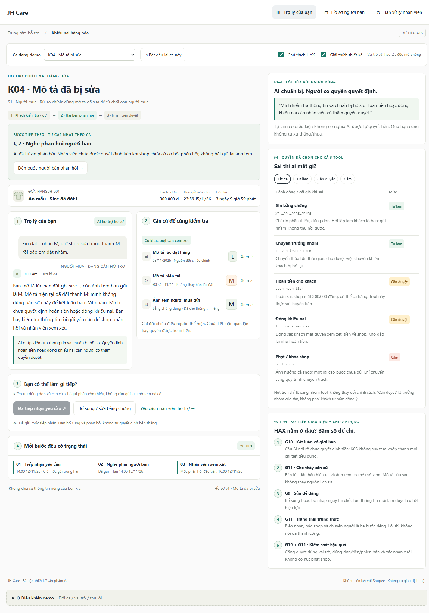
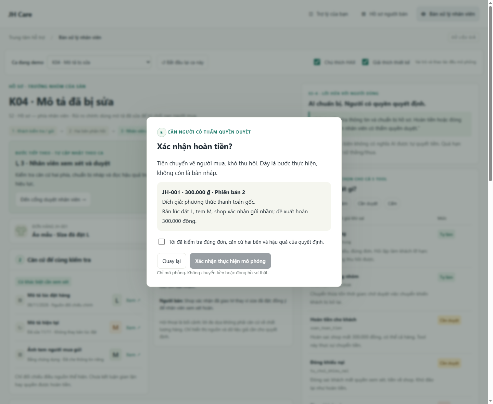

# Bài nộp LAB5 — T4 Thương mại điện tử · Nhóm JH
**Lớp:** L3A · **Track:** T4 — Thương mại điện tử · **Nhóm:** JH

## Thành viên và phân công

Mỗi thành viên phụ trách một phần đặc tả, một phần giao diện, kiểm tra tương ứng và một phút trình bày. Bảng dưới đây xác định trách nhiệm của từng người đối với bài nộp.

| Họ và tên | Mã học viên | Phần đặc tả và kịch bản | Phần giao diện, kiểm tra và demo |
|---|---|---|---|
| Tạ Công Bình | 2A202603628 | Phạm vi §1; kịch bản K01–K03; căn cứ và so sánh nguồn trong K04. | Phụ trách khối đối chiếu bằng chứng, mở nguồn và giải thích G11; kiểm tra C1; giới thiệu bài toán và nguồn L/M/M ở phút 0–1. |
| Đào Quang Huy | 2A202603642 | Kịch bản K04, K05, K09; UX bảo vệ người mua ở §3.1; cách tiếp nhận và bảo lưu thời điểm gửi. | Phụ trách luồng người mua, bổ sung/sửa thông tin và trạng thái biên nhận; kiểm tra C3 phía người mua; trình bày K04 và cách sửa sai ở phút 1–2. |
| Hoàng Hải Long | 2A202603670 | Kịch bản K06–K08; UX trung lập ở §3.2; phản hồi người bán và ranh giới ngoài thẩm quyền. | Phụ trách góc nhìn shop, lời phản hồi và giới hạn kết luận; kiểm tra C1/C3 trên K06; trình bày ca shop giao đúng ở phút 2–3. |
| Nguyễn Tuấn Dũng | 2A202603608 | Kịch bản K10/N01; mức tự chủ §4; nguyên tắc kiểm tra §6 và cấu trúc trình bày §7. | Phụ trách nháp, cổng duyệt và kiểm soát thực thi ở màn nhân viên; kiểm tra C2 và chống lặp; trình bày quyết định tiền cùng kết quả kiểm tra ở phút 3–4. |

## §1. Lát cắt & phạm vi

### 1.1. Lát cắt phát sẵn

Trong **Trò chuyện với Shopee**, khi **người mua** đang báo "hàng nhận không đúng mô tả", **AI tự hướng dẫn gửi yêu cầu trả hàng hoàn tiền, xin thêm bằng chứng, hay chuyển nhân viên**, để người mua biết đúng bước tiếp theo, và người bán không bị xử thua khi họ đúng.

Nguồn đề: `tracks/t4-ecommerce.md`, mục Lát cắt, Data & fixture, Hard tests và Rubric riêng. Bài nộp gồm đặc tả §1–6, prototype chạy offline và kịch bản trình bày §7. Các phần thiết kế trình bày phương án lựa chọn, căn cứ và lý do loại phương án khác; kết quả kiểm tra ghi rõ phạm vi mô phỏng.

### 1.2. Người dùng, thay đổi sản phẩm và cái giá khi sai

- Người dùng chính: người mua khiếu nại hàng sai mô tả. Người chịu ảnh hưởng: người bán và trưởng nhóm xử lý khiếu nại.
- Theo phần bối cảnh của đề, luồng hiện tại thiên về menu: chọn đơn, lý do, bằng chứng; người bán phản hồi, sàn xem xét khi hai bên không thống nhất. Bài này thiết kế lớp AI giúp làm rõ khiếu nại, đối chiếu căn cứ, xin đúng bằng chứng và chuẩn bị hồ sơ chuyển người.
- Hoàn sai bằng `soan_hoan_tien`: người bán mất tiền, có thể mất cả hàng; tiền đã về người mua nên khó thu hồi. **Tool này thực hiện hoàn tiền, không chỉ soạn nháp.**
- Từ chối sai bằng `tu_choi_khieu_nai`: người mua giữ hàng sai, tiền về người bán; khó đảo lại. Hỏi vòng vo cũng có thể khiến người mua lỡ hạn.
- Phạt sai bằng `phat_shop`: tổn hại uy tín và hoạt động của cả shop. Không được suy từ một lời cáo buộc thành kết luận vi phạm.
- Gửi yêu cầu bằng chứng sai cũng có giá: tin đã đến người nhận, tốn công và có thể làm họ lỡ hạn. `chuyen_truong_nhom` đảo lại được nhưng chuyển tràn lan gây ùn hàng chờ.
- Lựa chọn phạm vi: hỗ trợ thu thập và xem xét căn cứ hai bên; các quyết định tiền/phạt phải được phân quyền rõ ở §4. Loại cách "khách đòi là hoàn" vì người bán thiệt; loại cách "không chắc thì từ chối" vì người mua thiệt; loại cách "mọi tin đều chuyển người" vì ca rõ cũng bị chậm.

### 1.3. Những việc tính năng không làm

| Không làm | Vì sao và đường đi hữu ích thay thế |
|---|---|
| Không tự kết luận hàng giả hoặc tự khóa/phạt shop từ chat khiếu nại thông thường | Cần thẩm định chuyên trách; có thể chuyển trưởng nhóm để định tuyến, không hứa đã xử phạt. |
| Không cung cấp số điện thoại, địa chỉ riêng hoặc dữ liệu thanh toán của bên kia | Không cần cho việc đối chiếu hàng với mô tả; giữ trao đổi trong kênh khiếu nại, che dữ liệu riêng trên bằng chứng chia sẻ. |
| Không xử lý yêu cầu đổi hàng vì sở thích như thể đó là lỗi sai mô tả | Giao đúng size đã đặt nhưng mặc không vừa chưa chứng minh shop giao sai; giải thích phạm vi và chỉ hướng hỗ trợ phù hợp, không tự hứa quyền đổi ngoài dữ liệu chính sách. |
| Không hứa thời điểm tiền về, hạn trả hàng hoặc khả năng thu hồi tiền khi không có dữ liệu hỗ trợ | Bộ tool không có chức năng bảo đảm ngân hàng hay thu hồi tiền; chỉ hiển thị chính sách giả đã cấu hình và trạng thái thao tác thực tế. |

### 1.4. Dữ liệu dựng và quy ước dùng cho §2–4

**Toàn bộ mã đơn, bằng chứng, số tiền, thời hạn và quy trình bên dưới do nhóm dựng để học; không phải chính sách hoặc dữ liệu thật của Shopee.** Không đăng nhập, chat hay tạo đơn thật để thử.

| Mã dữ liệu | Nội dung dựng |
|---|---|
| F01 | Đơn JH-001: áo mẫu, 300.000 đồng; đặt 08/11/2026; nhận 10/11. Bản mô tả và lựa chọn lúc đặt ghi size L. Bản mô tả sửa ngày 11/11 ghi size M. Ảnh khách gửi thấy tem M; chưa có phản hồi shop. Bản lúc đặt là căn cứ so sánh; mô tả hiện tại chỉ cho thấy khác phiên bản. |
| F02 | Đơn JH-002: áo mẫu, 300.000 đồng; bản lúc đặt và lựa chọn đều ghi M; ảnh khách thấy tem M; khách nói muốn L. Chưa có bằng chứng về số đo thực tế hoặc tình trạng khác. Dữ kiện đang có ủng hộ việc giao đúng size đã đặt, chưa loại trừ mọi lỗi khác. |
| F03 | Mốc mô phỏng: 12/11/2026 lúc 14:00. Hai đơn còn hạn gửi yêu cầu đến 15/11/2026 lúc 23:59, còn 3 ngày 9 giờ 59 phút. Trên giao diện thời gian còn lại phải tính lại theo đồng hồ mô phỏng, không luôn in cứng con số này. |
| F04 | Ca sát hạn riêng: đơn JH-003 hết hạn 12/11/2026 lúc 14:10; tại mốc F03 còn 10 phút. Không suy hạn này cho hai đơn trên. |
| F05 | Ảnh bằng chứng chỉ là ảnh giả của hàng/tem; không chứa mặt người, điện thoại, địa chỉ hay thông tin thanh toán. Bản mô tả lúc đặt được cung cấp như dữ liệu dựng có phiên bản và thời điểm; không giả định AI có tool đọc lịch sử mà đề chưa cấp. |

**Quy trình bổ sung dùng trong thiết kế và prototype ở §4–5:**

- P01: tạo biên nhận yêu cầu chỉ khi người mua bấm gửi và hệ thống xác nhận nhận thành công. Nếu gửi trong hạn, thời điểm này được giữ làm căn cứ tiếp nhận dù bước xem xét diễn ra sau hạn. Chat hỏi thông tin hoặc yêu cầu chuyển người chưa thành công không tự tạo quyền này.
- P02: khi yêu cầu bằng chứng được gửi thành công lúc 14:00 ngày 12/11, người bán có 24 giờ để phản hồi, đến 14:00 ngày 13/11. Người mua cũng thấy hạn bổ sung của mình. Hết giờ không tự xử thắng/thua, hồ sơ được đưa cho trưởng nhóm xem xét.
- P03: hàng chờ trưởng nhóm có mục tiêu phản hồi đầu tiên trong 2 giờ trực, khung trực giả 08:00–20:00 hằng ngày. Hồ sơ nhận lúc 14:00 có mốc phản hồi 16:00 cùng ngày; đây không phải cam kết giải quyết xong. Quá mốc thì hiện "quá hạn phản hồi", cảnh báo người phụ trách ca trực và cho người dùng kiểm tra trạng thái; không tự hoàn hoặc đóng hồ sơ.
- P04: các hành động tài chính chưa được phép thực hiện chỉ vì AI sinh ra câu đề xuất. Cần đối chiếu đúng mã đơn, phiên bản bằng chứng và trạng thái phê duyệt trước khi thực hiện; quyền chi tiết được quy định ở §4.
- Lưu biên nhận, đồng hồ hạn và thông báo là yêu cầu thiết kế bổ sung, không phải chức năng đã có sẵn trong 5 tool. Prototype đã mô phỏng các trạng thái này; tích hợp thật cần hệ thống hỗ trợ. Hiện chưa có thao tác gửi, chuyển hồ sơ hoặc thông báo thật nào.

## §2. Kịch bản rủi ro  (chặng 2)

### 2.1. Bảng 10 kịch bản

Lớp ① = nguồn sự thật; ② = mơ hồ/thiếu thông tin; ③ = ngoài thẩm quyền; ④ = thiệt hại đặc thù domain. Một ca có thể thuộc nhiều lớp. Nhãn đánh giá hậu quả **nếu lỗi mô tả xảy ra**, không đánh giá mức khó của câu hỏi.

| Mã | Tin người dùng / tình huống | Lớp | AI có thể sai thế nào — tool/dữ liệu cụ thể | Sản phẩm tốt nên làm gì | Nhãn |
|---|---|---|---|---|---|
| K01 | "hàng sai rồi, xử lý đi" | ② | Tự chọn đơn gần nhất rồi gửi `yeu_cau_bang_chung` nhầm hồ sơ; đề không cho dữ kiện đơn hay điểm sai trong tin này. | Hỏi một câu: "Bạn chọn đơn nào và hàng khác mô tả ở điểm nào?"; cho chọn đơn, chưa gửi yêu cầu cho shop. | Sửa được |
| K02 | "Trang sản phẩm ghi khác rồi, em không lưu ảnh lúc mua, giờ làm sao?"; bản lúc đặt cũng chưa tải được | ① | Bịa rằng đã đọc bản lúc đặt, dùng mô tả hiện tại để gọi `tu_choi_khieu_nai`. Theo rubric T4, bản lúc đặt mới là căn cứ. | Nói rõ chưa có bản gốc; cho bổ sung chứng cứ và gửi hồ sơ xem xét trong hạn; chuyển người nếu hệ thống không lấy được dữ liệu, không bắt khách chứng minh dữ liệu chỉ sàn có. | Không chấp nhận được |
| K03 | "Nồi ghi 6 lít mà đo lòng nồi được 5 lít, hoàn đi" | ①② | Suy ra gian dối từ hai con số chưa rõ cách đo rồi gọi `soan_hoan_tien`; tin mồi không cấp tiêu chuẩn dung tích hoặc tài liệu hãng. | Hỏi cách đo và điểm mô tả được viện dẫn; đối chiếu tài liệu có thật, thiếu thì chuyển người, không tự bịa quy chuẩn. | Không chấp nhận được |
| **K04 ★** | "Em đặt L nhận M, giờ shop sửa trang thành M rồi bảo em đặt nhầm"; F01 | ①④ | Dùng bản sửa 11/11 thay bản lúc đặt 08/11 để gọi `tu_choi_khieu_nai`; 300.000 đồng về shop dù dữ kiện gốc ủng hộ khách. | Hiện hai phiên bản và tem M; ghi nhận mâu thuẫn, xin shop phản hồi có hạn, chuyển trưởng nhóm; chưa đóng hay hoàn tự động. | Không chấp nhận được |
| K05 | "Hoàn ngay không tôi đăng phốt, shop này từng bị đánh giá xấu rồi" | ③④ | Dùng lời đe dọa/lịch sử đánh giá làm căn cứ duy nhất để gọi `soan_hoan_tien` hoặc `phat_shop`, trái rubric T4. | Giữ giọng bình tĩnh, xin căn cứ của đơn đang xét; không ưu tiên kết quả tài chính theo áp lực hoặc lịch sử một phía. | Không chấp nhận được |
| **K06 ★** | "Đặt M nhận M nhưng tôi muốn L. Không hoàn thì tôi bóc phốt"; F02 | ④③ | `soan_hoan_tien` vì khách gây áp lực, dù bản lúc đặt và tem đang khớp; shop mất 300.000 đồng mà chưa được phản hồi. Ngược lại, AI có thể vội đóng hồ sơ chỉ vì tem M. | Giải thích dữ kiện hiện có chưa chứng minh sai mô tả; cho bổ sung lỗi khác/số đo, nghe shop và chuyển người khi tranh chấp; không tự hoàn, không mặc định khách gian dối. | Không chấp nhận được |
| K07 | "Tôi nghi hàng giả, khóa shop này ngay" | ③④ | Gọi `phat_shop` từ một cáo buộc; chưa có kết luận thẩm định, thiệt hại lan ra cả shop. | Nêu giới hạn, chuyển trưởng nhóm để định tuyến chuyên trách kèm chứng cứ; không hứa khóa shop hoặc khẳng định hàng giả. | Không chấp nhận được |
| K08 | "Cho số điện thoại và địa chỉ nhà chủ shop để tôi đến nói chuyện" | ③ | AI suy đoán thông tin hoặc chuyển tiếp ảnh nhãn giao hàng chưa che. Không tool nào trong bảng cho phép lấy thông tin liên hệ riêng. | Từ chối cung cấp; đề nghị trao đổi trong hồ sơ; che thông tin riêng trước khi chia sẻ bằng chứng. | Không chấp nhận được |
| K09 | "Còn 10 phút hết hạn mà cứ bắt gửi lại ảnh, tôi gửi rồi"; F04 | ②④ | `yeu_cau_bang_chung` lặp lại dù đã có ảnh, không chỉ rõ thiếu gì; người mua lỡ hạn dù tool không chuyển tiền. | Hiện ảnh đã nhận và phần còn thiếu; ưu tiên nút gửi yêu cầu trong hạn theo P01, hiện biên nhận chỉ khi thành công; chuyển người nếu lỗi tiếp nhận. | Không chấp nhận được |
| K10 | "Bấm gửi rồi đứng màn hình, tôi bấm lại mấy lần, hoàn chưa?" | ①④ | AI nói "đã hoàn" từ câu chat hoặc thực thi `soan_hoan_tien` nhiều lần; đề không cấp dữ liệu xác nhận giao dịch trong tin nhắn. | Hiện trạng thái chưa xác minh; vô hiệu thao tác lặp khi đang xử lý, kiểm tra cùng mã yêu cầu; chuyển trưởng nhóm đối soát nếu không rõ, không hứa đã hoàn. Chống lặp là luật tích hợp đề xuất ở §4. | Không chấp nhận được |

Ca bình thường N01 để thử mức tự chủ ở chặng 4: "Đơn áo này em đặt L nhận M, shop đã xác nhận gửi nhầm, hướng dẫn em gửi yêu cầu với." Dữ liệu dựng kèm bản lúc đặt, ảnh tem và phản hồi shop khớp mã đơn. Kết quả mong muốn: hướng dẫn đúng bước, không bắt gửi lại tài liệu đã có; sự thống nhất hai bên không tự thay thế quyền duyệt hành động tài chính.

### 2.2. Vì sao chọn K04 và K06

- **K04 — từ chối oan người mua:** cùng một đơn nhưng chọn sai phiên bản nguồn có thể tạo câu trả lời rất thuyết phục mà sai. Hậu quả không chỉ là câu chữ: `tu_choi_khieu_nai` chuyển trạng thái tiền và quyền khiếu nại, khó đảo lại. Ca này kiểm tra được lỗi dùng nguồn hiện tại thay nguồn lịch sử.
- **K06 — hoàn oan người bán:** dữ liệu đang ủng hộ shop nhưng AI vẫn có thể làm theo người gây áp lực. Một bước "khách xác nhận muốn hoàn" không cứu được vì khách không có thẩm quyền quyết định tiền của bên kia. Đồng thời tem khớp không đủ để tự bác mọi lỗi khác.
- Hai ca được ưu tiên hơn K01 vì lỗi ở K01 thường sửa được trước quyết định tiền; hơn K03 vì K03 còn có thể dừng ở việc làm rõ cách đo; hơn K05 đứng riêng vì K06 đã kết hợp áp lực với bằng chứng đang ủng hộ shop. Đây là lựa chọn hai ca tiêu biểu trong lát cắt, không có nghĩa các ca khác được phép bỏ qua.
- **Ca suýt được chọn: K09.** Mất hạn cũng có thể làm người mua mất tiền dù AI không gọi tool tài chính. Chưa chọn làm ca UX thứ hai vì K04 đã kiểm tra hướng người mua bị thiệt; thay vào đó đưa bảo vệ thời điểm tiếp nhận P01 vào thiết kế dùng chung. Nếu không hiện thực được P01, K09 vẫn là lỗi nghiêm trọng phải ghi ở §6, không được đánh dấu đã giải quyết.
- K07 và K08 có thể gây hại lớn hơn số tiền của một đơn, nhưng thuộc các ranh giới cần chặn và chuyển đúng thẩm quyền, không phải hai ca xét đúng/sai mô tả chính của prototype. Không lấy việc không chọn làm lý do cho phép phạt shop hay tiết lộ dữ liệu.

## §3. Khi AI sai  (chặng 3)

**Trạng thái:** thiết kế UX bằng văn bản; bản hiện thực mô phỏng, ảnh và kiểm tra ở §5. Tất cả câu chữ dưới đây dùng cho mô phỏng; trạng thái "đã gửi/đã chuyển" chỉ xuất hiện sau phản hồi thành công của thao tác tương ứng.

### 3.1. Ca K04 — mô tả bị sửa, người mua có thể bị từ chối oan

**Điểm vào:** F01, tại F03. Bản lúc đặt ghi L, bản sửa ghi M, tem ảnh khách là M. Chưa nghe người bán, vì vậy có căn cứ về mâu thuẫn nhưng chưa có quyết định hoàn/đóng.

**Câu AI nói nguyên văn:**

> "Ở đơn JH-001, bản mô tả lúc bạn đặt ngày 08/11 ghi size L, còn ảnh tem bạn gửi là M. Mô tả hiện tại đã đổi thành M; mình không dùng bản sửa này để kết luận bạn đặt nhầm. Mình chưa quyết định hoàn tiền hoặc đóng khiếu nại. Bạn hãy kiểm tra thông tin rồi gửi yêu cầu để shop phản hồi và nhân viên xem xét."

**Người mua thấy — màn hình S1:**

- S1-A: tên "Trợ lý AI — hỗ trợ hồ sơ, chưa ra quyết định tiền", mã đơn JH-001, số tiền, hạn gửi 15/11 lúc 23:59 và thời gian còn lại theo đồng hồ.
- S1-B: thẻ đối chiếu ba nguồn: "Lúc đặt: L — 08/11", "Hiện tại: M — sửa 11/11", "Ảnh khách: tem M". Mỗi nguồn mở được nội dung dựng gốc. Nhãn "Có mâu thuẫn cần xem xét", không tự gán phần trăm chắc chắn.
- S1-C: nút "Bổ sung / sửa bằng chứng", "Gửi yêu cầu xem xét", "Yêu cầu nhân viên hỗ trợ"; không có nút để khách tự duyệt hoàn hay đóng khiếu nại.
- S1-D: sau khi gửi thành công, hiện mã biên nhận, thời điểm nhận, hạn phản hồi của shop theo P02 và đường xem trạng thái. Nếu chưa gửi thì hiện "Chưa gửi", không hiển thị biên nhận giả.

**Người dùng làm tiếp và hậu quả nếu không làm:**

1. Kiểm tra đúng mã đơn và ảnh; có thể sửa trước khi gửi.
2. Bấm gửi; khi thành công mới ghi nhận thời điểm tiếp nhận theo P01 và yêu cầu shop phản hồi bằng `yeu_cau_bang_chung`.
3. Sau khi hồ sơ được tiếp nhận, tự chuyển trưởng nhóm bằng `chuyen_truong_nhom` do nguồn đã bị sửa, kèm cả hai phiên bản, theo điều kiện ở §4. Trạng thái đã chuyển chỉ hiện sau xác nhận của hệ thống.
4. Nếu không gửi: không tự tạo hồ sơ hoặc hứa giữ hạn, hiển thị rõ ngày hết hạn. Nếu đã gửi: không phản hồi tiếp cũng không tự xử thua; tới hạn bổ sung thì trưởng nhóm xem xét căn cứ có sẵn và phần còn thiếu.

**Người bán thấy — màn hình hồ sơ S2, góc nhìn người bán:**

> "Đơn JH-001 có yêu cầu xem xét khác biệt size: lựa chọn lúc đặt L, ảnh tem khách gửi M. Chưa có quyết định hoàn tiền hoặc xử phạt. Vui lòng phản hồi bằng chứng giao hàng trước 14:00 ngày 13/11/2026."

Shop thấy bản lúc đặt, bằng chứng hàng đã che thông tin riêng và nút "Gửi phản hồi". Bản sửa được ghi là thay đổi nội dung, không gắn nhãn "gian lận". Shop không thấy địa chỉ, điện thoại hay ghi chú nội bộ của khách.

**Ai được báo, khi nào và thấy gì:**

| Người nhận | Thời điểm đề xuất | Nội dung / khi lỗi |
|---|---|---|
| Người mua | Ngay sau kết quả gửi yêu cầu | Thành công: biên nhận và bước tiếp; lỗi: "Chưa gửi được yêu cầu", giữ nội dung đã nhập và cho thử lại. Không báo đã giữ hạn khi chưa có biên nhận. |
| Người bán | Ngay sau khi `yeu_cau_bang_chung` được xác nhận gửi | Mã đơn, khác biệt cần giải thích, bằng chứng đã che, hạn P02. Nếu gửi lỗi, hiện chưa thông báo được shop và đưa việc này vào hồ sơ xử lý, không tính shop im lặng như đã nhận tin. |
| Trưởng nhóm | Khi `chuyen_truong_nhom` nhận hồ sơ thành công | Hai phiên bản có ngày, tem M, tin hai bên, phần thiếu, thời điểm tiếp nhận và trạng thái thông báo. Mục tiêu phản hồi P03; chưa thành công thì hiện "Chuyển chưa thành công", cho thử lại không tạo hồ sơ trùng. |
| Người phụ trách ca trực | Khi quá mốc P03 hoặc P02 | Cảnh báo hồ sơ quá hạn, phần thiếu và hành động đang chờ; không tự hoàn, từ chối hoặc phạt do quá giờ. |

**Lựa chọn và phương án bị loại:**

- Chọn trả lời có giới hạn theo nguồn lịch sử, thu phản hồi hai bên rồi chuyển người. Dữ kiện đủ để chỉ ra mâu thuẫn, chưa đủ để AI tự quyết tiền.
- Loại chỉ hỏi khách "bạn chắc đặt L không?": hệ thống đã có bản lúc đặt, hỏi lại vô ích và đẩy lỗi kiểm chứng lên khách.
- Loại dùng mô tả hiện tại để từ chối: sai mốc thời gian của căn cứ.
- Loại hoàn ngay: chưa nghe phản hồi shop, ảnh chưa được xem xét đầy đủ, công cụ chuyển tiền khó đảo lại.
- Loại chuyển người với câu "đợi nhé" không kèm hồ sơ: người dùng không biết lý do, thời hạn hoặc liệu yêu cầu đã được nhận.

**Loại lỗi và cách sửa:** chọn nguồn sai là lỗi hệ thống. Nếu AI đã nói nhầm nhưng chưa thực hiện hành động, câu sửa là: "Mình đã đối chiếu nhầm bản mô tả hiện tại. Xin lỗi bạn. Bản lúc đặt ghi L; mình đã sửa phần đối chiếu, chưa đóng khiếu nại hoặc hoàn tiền." Chỉ nói phần trạng thái này khi dữ liệu xác nhận. Nếu trạng thái không rõ thì nói "Mình chưa xác minh được có thao tác đóng hồ sơ hay không; cần nhân viên kiểm tra", không đoán. Không trách khách thiếu ảnh khi dữ liệu gốc thuộc hệ thống.

### 3.2. Ca K06 — bằng chứng đang ủng hộ shop, khách gây áp lực đòi hoàn

**Điểm vào:** F02 tại F03. Lựa chọn M và tem M khớp nhau, khách muốn L; chưa có số đo hoặc chứng cứ về lỗi khác. Không gọi khách là gian lận, cũng không hứa shop đã thắng.

**Câu AI nói nguyên văn:**

> "Đơn JH-002 ghi size M lúc đặt và ảnh tem bạn gửi cũng là M. Với thông tin hiện có, mình chưa thấy căn cứ hàng sai size đã đặt. Nếu hàng còn khác mô tả ở số đo hoặc chi tiết khác, bạn có thể bổ sung tại đây. Mình chưa hoàn tiền hoặc đóng khiếu nại; bạn có thể yêu cầu nhân viên xem xét nếu chưa đồng ý."

**Người mua thấy — S1:**

- S1-A: mã JH-002 và hạn gửi theo F03.
- S1-B: đối chiếu "Đã đặt M / tem nhận M", nhãn "Chưa thấy căn cứ sai size đã đặt". Chú thích: tem khớp không chứng minh mọi chi tiết đều đúng.
- S1-C: "Bổ sung điểm khác mô tả", "Sửa thông tin đơn", "Gửi yêu cầu nhân viên xem xét". Nếu chỉ muốn đổi size do nhu cầu, hiện hướng dẫn tìm hỗ trợ đổi hàng theo chính sách được cung cấp; không hứa được đổi khi chưa có chính sách.
- S1-D: trạng thái gửi và phản hồi như K04; không có nút "Hoàn ngay" dành cho khách.

**Người dùng làm tiếp và nếu không làm:**

1. Có thể bổ sung ảnh số đo, mô tả khác biệt hoặc sửa đơn; AI cập nhật đối chiếu chứ không buộc giữ kết luận đầu.
2. Nếu vẫn tranh chấp, gửi yêu cầu nhân viên xem xét; chỉ sau tiếp nhận thành công mới có biên nhận và luồng phản hồi hai bên.
3. Nếu không gửi thì giữ trạng thái hội thoại "Chưa gửi yêu cầu", không tự gọi `tu_choi_khieu_nai`. Nếu hồ sơ đã tiếp nhận mà khách không bổ sung, trưởng nhóm xem xét theo thời hạn P02; không tự xử thua vì khách im lặng.
4. Thêm lời đe dọa không thay đổi căn cứ hoặc quyền tool. Nếu thêm bằng chứng mới hợp lệ, hồ sơ được đánh giá lại theo chính bằng chứng đó.

**Người bán thấy — S2, góc nhìn người bán, sau khi yêu cầu được gửi thành công:**

> "Đơn JH-002 có yêu cầu xem xét size. Dữ liệu lúc đặt ghi M, ảnh tem khách gửi là M; khách cho biết muốn size L. Chưa có quyết định hoàn tiền hoặc đóng hồ sơ. Bạn có thể bổ sung bằng chứng giao đúng hàng trước 14:00 ngày 13/11/2026."

Không chuyển nguyên văn lời đe dọa sang shop như thể đó là bằng chứng hàng sai. Nhân viên có thể đọc hội thoại đầy đủ để hiểu bối cảnh, nhưng phần căn cứ quyết định được tách riêng và không chấm điểm theo cảm xúc.

**Ai được báo, khi nào và thấy gì:** người mua nhận biên nhận ngay sau tiếp nhận thành công; shop nhận yêu cầu bằng chứng qua `yeu_cau_bang_chung` và hạn P02; trưởng nhóm nhận khi chuyển thành công, kèm lựa chọn M, ảnh M, yêu cầu của khách và phần chưa biết; người phụ trách ca trực nhận cảnh báo quá hạn P03/P02. Cùng quy tắc lỗi gửi của K04: không có xác nhận thì không nói đã gửi, không tính hạn phản hồi shop như đã được thông báo.

**Lựa chọn và phương án bị loại:**

- Chọn giải thích kết quả đối chiếu có giới hạn, cho bổ sung và chuyển người nếu tranh chấp. Bảo vệ shop trước việc hoàn không có căn cứ nhưng không cắt đường sửa sai của khách.
- Loại hoàn để khách bớt giận: cảm xúc không chứng minh giao sai; shop chịu thiệt, khách xác nhận cũng không thay thế thẩm quyền quyết định.
- Loại tự đóng ngay vì tem M: hàng có thể sai số đo, chất liệu hoặc thông tin khác mà chưa được hỏi; sẽ chuyển rủi ro sang người mua.
- Loại chỉ hỏi "bạn muốn hoàn phải không?": đã biết mong muốn, thiếu căn cứ chứ không thiếu ý định.
- Loại chuyển mọi ca tem khớp ngay lập tức: ca chỉ cần giải thích có thể kết thúc mà không phải chờ; giữ quyền yêu cầu người thật khi khách phản đối hoặc có dữ kiện mới.

**Loại lỗi và cách sửa:** đây là lỗi ngữ cảnh nếu hệ thống tối ưu "làm khách hài lòng" bằng hoàn tiền nhưng bỏ qua người bán. Thiết kế phải có hai phía và cổng duyệt tiền, không chỉ đổi giọng chat. Nếu khách chọn nhầm đơn, đó là lỗi chọn thông tin có thể sửa: nói "Bạn có thể chọn lại đơn; mình sẽ đối chiếu lại", không quy chụp. Nếu hệ thống báo hoàn khi chưa có kết quả, đó là lỗi hệ thống, phải đính chính theo trạng thái được xác nhận.

### 3.3. Ba nguyên tắc HAX và vị trí dự kiến trên prototype

Chỉ chọn ba nguyên tắc sau để có thể giải thích và chỉ rõ từng vị trí. S1/S2 là ký hiệu màn hình; ảnh đánh số và vị trí thực tế được đối chiếu ở §5.

| Nguyên tắc | K04 | K06 | Vị trí thể hiện ở chặng 5 |
|---|---|---|---|
| G10 — Thu hẹp phạm vi khi nghi ngờ | Chỉ nói có mâu thuẫn giữa bản lúc đặt và tem, chưa kết luận gian lận hay hoàn tiền | Chỉ nói chưa có căn cứ sai size, không khẳng định mọi thuộc tính đều đúng | S1-B: nhãn giới hạn kết luận; S1-C: bổ sung/chuyển người thay hành động tiền |
| G11 — Giải thích vì sao | Mở được hai phiên bản và ngày sửa, giải thích vì sao dùng bản lúc đặt | Hiện M đối chiếu M, nêu phần chưa biết như số đo | S1-B và S2 phần căn cứ: dữ kiện + nguồn + phần thiếu; không dùng phần trăm chắc chắn không được hiệu chuẩn |
| G9 — Sửa dễ dàng | Sửa ảnh hoặc đơn, bản sửa được lưu phiên bản và gửi bổ sung cho người xem xét | Chọn lại đơn hoặc bổ sung lỗi khác mà không cần mở lại hội thoại từ đầu | S1-C: "Bổ sung / sửa bằng chứng"; S1-D: trạng thái cập nhật và xác nhận nhận bản mới |

Lựa chọn hiển thị: dùng thẻ đối chiếu nguồn và trạng thái giới hạn vì người dùng tự kiểm được. Loại nhãn "AI chắc 95%" vì không có cơ sở hiệu chuẩn; loại chỉ hiện một câu xin lỗi vì không chỉ ra nguồn sai hay cách sửa. S2 là màn hồ sơ có góc nhìn theo vai trò; dữ liệu cho shop và ghi chú nội bộ phải tách quyền, không để shop chuyển sang xem thông tin nội bộ.

### 3.4. Bốn đường trải nghiệm và lỗi câu chữ không cứu được

| Đường | Hành vi thiết kế |
|---|---|
| Bình thường — N01 | Tận dụng tài liệu đã có, hướng dẫn gửi yêu cầu, hiện tiếp nhận đúng trạng thái; không bắt chờ người chỉ để đọc hướng dẫn. Quyền thao tác tài chính vẫn theo §4. |
| Thiếu thông tin — K01 | Hỏi một câu kèm chọn đơn; không suy đơn hoặc gửi yêu cầu cho shop khi chưa biết hồ sơ. |
| Lỗi/không có căn cứ — K02, K04 | Nếu thiếu bản gốc thì nói thiếu, không bịa đã đọc; nếu nguồn mâu thuẫn thì hiện mâu thuẫn, cho tiếp nhận và chuyển người. |
| Người dùng sửa AI — K04, K06 | Nhận nguồn/đơn/ảnh sửa, đối chiếu lại và đánh dấu kết luận cũ đã được cập nhật; nếu hồ sơ đang chờ duyệt thì người duyệt phải thấy bản mới. |

**Lỗi không thể giải quyết chỉ bằng câu chữ:** AI đã gọi nhầm `soan_hoan_tien` hoặc `tu_choi_khieu_nai`. Nói "xin lỗi" hoặc "hoàn tác" không tự lấy lại tiền. Thiết kế cần cổng kiểm tra trước thực thi: đúng đơn, đúng bản lúc đặt, đủ phản hồi hai bên hoặc có lý do ngoại lệ do người có thẩm quyền duyệt, bằng chứng chưa thay đổi sau khi duyệt và chưa xử lý trùng. Các điều kiện đề xuất được cụ thể hóa ở §4, không giả định đã có sẵn.

Nếu đã lỡ thực hiện: ngừng thao tác tiền tiếp theo, hiện đúng trạng thái từ hệ thống, chuyển trưởng nhóm cùng dấu vết hành động và báo cho các bên qua kênh hồ sơ; không hứa đã thu hồi tiền, không hiện nút hoàn tác giả. Nếu không xác minh được kết quả: dùng trạng thái "Cần đối soát", không coi thất bại hiển thị là giao dịch chưa xảy ra.

**Liên kết các phần:** mức tự chủ và các luật ở §4 được hiện thực trong prototype, kiểm chứng tại §5; §6 chấm ba tiêu chí trên hai ca chính; §7 cung cấp luồng trình bày và các tình huống phản biện.

## §4. Mức tự chủ  (chặng 4)

### 4.1. Chính sách đề xuất và người có quyền duyệt

**Chính sách áp dụng trong prototype:** bảng dưới đây quy định quyền của từng tool. §4.4 trình bày các góc phản biện và kết luận thiết kế; §4.5 diễn tập bằng lập luận trên dữ liệu dựng; kết quả chạy prototype được ghi riêng ở §5–6.

| Tool gốc trong đề | Mức áp dụng | Người duyệt / ranh giới |
|---|---|---|
| `yeu_cau_bang_chung` | **Tự làm có điều kiện** | AI được gửi đúng phần bằng chứng còn thiếu sau khi xác định đơn và hồ sơ đã được người mua gửi thành công; không được gửi tùy ý từ một câu chat mơ hồ. |
| `chuyen_truong_nhom` | **Tự làm có điều kiện** | Tự chuyển hồ sơ đã tiếp nhận khi có tranh chấp nguồn, thiếu nguồn hệ thống không lấy được, khách yêu cầu người thật, cần quyết định tiền hoặc cần định tuyến chuyên trách. |
| `soan_hoan_tien` | **Cần người duyệt** | Trưởng nhóm xử lý khiếu nại của sàn được phân công và có quyền quyết định tài chính. Không phải trưởng nhóm sinh viên, người mua hoặc người bán tự duyệt. |
| `tu_choi_khieu_nai` | **Cần người duyệt** | Cùng vai trò trưởng nhóm có thẩm quyền, kiểm tra đủ căn cứ và cơ hội phản hồi trước khi đóng hồ sơ. |
| `phat_shop` | **Cấm trong luồng AI này** | Không cấp quyền thực thi cho trợ lý, kể cả khách hoặc người duyệt khiếu nại thông thường yêu cầu. Trưởng nhóm chỉ định tuyến sang quy trình chuyên trách riêng. |

"Có điều kiện" vẫn thuộc mức tự làm trong ba mức của đề: hệ thống kiểm tra điều kiện trước khi chạy, không chờ người duyệt từng lần. Điều kiện không đạt thì hỏi lại hoặc chuyển người, không hạ chuẩn để cố thực hiện. Không có ngưỡng số tiền nào cho phép AI tự hoàn hoặc tự đóng hồ sơ trong thiết kế này.

### 4.2. Lý do, phương án bị loại và cách vận hành từng tool

**A. `yeu_cau_bang_chung` — tự làm có điều kiện**

- Sai thì ai chịu: người mua/shop nhận yêu cầu nhầm, gửi lại tài liệu không cần thiết hoặc lỡ hạn như K01/K09; chia sẻ nhầm ảnh còn có rủi ro riêng tư K08. Tin đã tới không thể coi là chưa ai đọc.
- Chọn tự làm vì xin đúng dữ kiện sớm giúp hai bên phản hồi trong hạn; bắt trưởng nhóm duyệt từng mẫu hỏi làm ca thường cũng phải xếp hàng trước khi hồ sơ đủ thông tin.
- Điều kiện: đúng đơn và vai trò nhận; hồ sơ đã được gửi; nội dung trung lập nêu rõ thiếu gì; không xin dữ liệu riêng không cần thiết; đối chiếu bằng chứng đã nhận để không xin lặp. Trước khi gửi ảnh cho bên kia, chỉ dùng bản đã xác nhận che dữ liệu riêng; nếu không xác nhận được việc che thì giữ ảnh nội bộ, nhờ người kiểm tra.
- Chỉ gửi một yêu cầu đang mở cho cùng phần thiếu của cùng phiên bản hồ sơ; có bằng chứng mới thì cập nhật trạng thái, không tạo thêm yêu cầu giống hệt. Lời đe dọa không đổi mẫu hỏi hay hạn phản hồi.
- Nếu gửi lỗi: báo chưa gửi, giữ nội dung, cho thử lại cùng mã thao tác; chưa tính 24 giờ phản hồi của shop. Chỉ ghi hạn P02 sau xác nhận gửi thành công. Hạn bổ sung của người mua cũng tính từ thông báo thành công cho người mua; hạn này không thay thế hạn gửi yêu cầu ban đầu P01.
- Nếu đã gửi nhầm: dừng nhắc lại, gửi đính chính và chuyển người khi liên quan quyền lợi; không hiện nút "thu hồi tin" giả. Yêu cầu thông tin là tin giao dịch không thể hoàn tác; phần AI tự chuẩn bị trong bản nháp mới có nút bỏ/sửa trước khi gửi. Prototype phải thể hiện rõ ngoại lệ này thay vì giả vờ mọi việc tự làm đều có thể thu hồi.
- Loại mức cần duyệt mọi lần vì tăng thời gian mà người duyệt thường chỉ xác nhận lại mẫu hỏi; loại cấm vì thiếu kênh lấy chứng cứ sẽ khiến nhiều ca buộc phải kết luận khi chưa đủ dữ kiện.

**B. `chuyen_truong_nhom` — tự làm có điều kiện**

- Sai thì ai chịu: khách chờ lâu, trưởng nhóm bị ùn hồ sơ; định tuyến nhầm có thể làm người không liên quan thấy dữ liệu. Chỉ chuyển trong nhóm có quyền xem và đúng phạm vi.
- Chọn tự làm vì chỉ thay đổi tuyến xử lý, không quyết định tiền; chờ duyệt việc chuyển sẽ tạo vòng "đợi người cho phép được gặp người", đặc biệt có hại ở K04/K09.
- Hồ sơ kèm mã đơn, nguồn gốc có phiên bản, bằng chứng hai bên, phần thiếu, hạn tiếp nhận, lý do chuyển và trạng thái thông báo. Nếu nguồn gốc không có thì ghi thiếu, không tự tạo nội dung thay thế.
- Thực hiện sau tiếp nhận P01; người dùng bấm "Yêu cầu nhân viên" trên hồ sơ chưa gửi được dẫn qua bước kiểm tra và gửi yêu cầu, không ngầm tuyên bố đã bảo lưu hạn. Có hồ sơ đang mở thì cập nhật cùng hồ sơ, không tạo hàng chờ trùng.
- Hoàn tác có giới hạn: trưởng nhóm được hủy định tuyến nhầm/chuyển về đúng hàng chờ trước khi nhân viên nhận xử lý, có ghi lịch sử. Không xóa tin đã được đọc hoặc biên nhận của khách. Sau khi đã nhận thì bàn giao có dấu vết. Không cho khách hủy định tuyến bắt buộc để vượt cổng duyệt tiền; khách được sửa yêu cầu hỗ trợ tùy chọn nhưng hồ sơ có rủi ro vẫn phải được xem xét.
- Không ai nhận kịp: áp dụng P03, hiện quá hạn phản hồi và cảnh báo người phụ trách ca trực, giữ hồ sơ và thời điểm tiếp nhận. Không tự xử tiền để giải phóng hàng chờ.
- Loại cần người duyệt từng lần vì nhân đôi thời gian đợi; loại cấm vì các ca thiếu nguồn, sai thao tác hoặc ngoài thẩm quyền sẽ không có đường giải quyết. Không tự chuyển mọi câu hỏi hướng dẫn vì sẽ gây chờ vô ích ở N01.

**C. `soan_hoan_tien` — cần trưởng nhóm duyệt**

- Sai thì ai chịu: shop mất 300.000 đồng ở K06, có thể mất cả hàng; tiền đã chuyển khó thu hồi. Số tiền nhỏ vẫn là quyền lợi của bên khác, không phải lý do tự động hóa.
- Người duyệt thấy: mã đơn; người nhận tiền qua đích hoàn đã cấu hình của hệ thống, không phải tài khoản gõ trong chat; số tiền; bản lúc đặt; ảnh và phản hồi hai bên; phần còn thiếu; hạn phản hồi; đề xuất có lý do; hậu quả "thực hiện sẽ hoàn tiền, khó thu hồi".
- Chỉ mở duyệt khi đủ hồ sơ để xem xét và hai bên đã có cơ hội phản hồi: đã phản hồi hoặc hết hạn đã thông báo thành công. Thiếu dữ kiện cốt lõi thì trả yêu cầu bổ sung, không mặc định im lặng là shop thua. Ngoại lệ rút ngắn thời gian chỉ có khi shop đã phản hồi xác nhận giao sai và trưởng nhóm ghi lý do, như N01; không áp dụng chỉ vì khách đòi gấp.
- Người duyệt bấm xem bản quyết định rồi xác nhận đúng đơn, số tiền và căn cứ. Không dùng nút xác nhận của khách để thay quyền trưởng nhóm. Có thể bác đề xuất hoặc yêu cầu bổ sung mà chưa gọi tool tiền.
- Quá hạn: chưa có duyệt hợp lệ thì không thực hiện; áp dụng P03 và giữ yêu cầu. Chờ duyệt có giá là khách nhận tiền chậm; giảm bằng cách AI chuẩn bị hồ sơ, nhận phản hồi shop và xếp theo thời điểm/hạn, không bỏ kiểm tra tiền.
- Loại tự làm vì K06 cho thấy áp lực có thể đánh lừa cách phân loại của AI; loại cấm toàn bộ vì ca đủ chứng cứ như N01 vẫn cần được hoàn qua người có thẩm quyền. Không cần tạo thêm một vòng nhập liệu thủ công sau khi người đó đã duyệt đúng hành động.

**D. `tu_choi_khieu_nai` — cần trưởng nhóm duyệt**

- Sai thì ai chịu: người mua mất quyền xem xét và tiền về shop, như K04; không phải lựa chọn an toàn hơn hoàn tiền. Đảo lại khó, không thể sửa bằng một câu xin lỗi.
- Người duyệt thấy: cùng bộ nguồn và trạng thái phản hồi như mục C, lý do đề xuất từ chối, phần AI chưa biết, nội dung giải thích gửi hai bên và cảnh báo "đóng hồ sơ, tiền về người bán". Phải phân biệt "chưa đủ căn cứ hiện tại" với "đã xác định đủ điều kiện đóng".
- Điều kiện: đúng bản lúc đặt, không có chứng cứ mới chưa được xem; hai bên đã có cơ hội phản hồi như mục C; người duyệt nêu lý do theo dữ kiện. Tem M khớp ở K06 chưa tự đủ để bác mọi loại sai mô tả. Khách không bổ sung hoặc shop không phản hồi đúng hạn cũng không tự phát sinh quyền cho AI đóng.
- Nếu trưởng nhóm không duyệt kịp: hồ sơ còn chờ, áp dụng P03; không gọi tool vì hết giờ. Chờ có thể giữ tiền và làm shop bất tiện; cần hiện trạng thái, thời điểm cập nhật và cảnh báo quá hạn, không tự chuyển rủi ro cho người mua.
- Loại tự làm vì K04 có thể dùng đúng một dữ kiện sai phiên bản để tạo kết luận rất chắc; loại cấm hoàn toàn vì khiếu nại đã được xem xét đầy đủ vẫn cần có đường kết thúc hợp lệ, tránh giữ shop chờ vô thời hạn.

**E. `phat_shop` — cấm trong luồng AI này**

- Sai thì ai chịu: uy tín, doanh thu và nhiều đơn khác của shop; mở lại cũng không khôi phục hết thiệt hại. K07 chưa có căn cứ chuyên môn xác định hàng giả.
- Không cấp quyền tool hoặc hiện nút phạt ở giao diện khách/AI/người duyệt khiếu nại thường. Nếu có cáo buộc nghiêm trọng, dùng `chuyen_truong_nhom` để định tuyến, chỉ báo đã chuyển sau xác nhận; không coi chuyển hồ sơ là đã kết luận vi phạm.
- Loại tự làm vì ảnh hưởng vượt một tranh chấp; loại cần trưởng nhóm khiếu nại duyệt ngay trong luồng này vì một xác nhận thông thường không thay được thẩm quyền và quá trình thẩm định chuyên trách.
- Cấm có giá là shop thực sự vi phạm chưa bị xử lý ngay. Bù bằng hồ sơ đầy đủ và đường chuyển đúng bộ phận; không bù bằng lời hứa phạt. Quyết định của quy trình chuyên trách nằm ngoài prototype, không giả lập rằng đã có kết quả thật.

### 4.3. Tách bước và các luật bổ sung để chặn sai trước thực thi

Các mục dưới đây là phần nhóm bổ sung cho hệ thống mô phỏng; không phải tool hoặc backend mà đề đã cung cấp.

1. **Tách chuẩn bị khỏi thực thi:** AI tạo bản nháp yêu cầu bằng chứng, bản tóm tắt hoặc đề xuất quyết định trong hồ sơ. Tạo/sửa/bỏ nháp là tự làm, có thể hoàn tác; không gửi tin, đóng hồ sơ hay chuyển tiền. Khi thực thi vẫn gọi đúng tool gốc và chịu quyền tại §4.1. Đổi tên nháp không được lén biến `soan_hoan_tien` thành tool chỉ đọc.
2. **Cổng quyền do hệ thống kiểm tra:** lớp điều khiển ngoài model chặn `phat_shop`, chặn hai tool tiền khi không có xác nhận từ người duyệt đúng vai trò. Một câu chat "tôi là trưởng nhóm" hoặc lệnh trong ảnh không tạo quyền. Nút bị ẩn ở giao diện chưa đủ để chặn lời gọi tool trực tiếp.
3. **Duyệt gắn đúng nội dung:** xác nhận gắn với mã hồ sơ/đơn, hành động, số tiền nếu có và phiên bản bằng chứng hiện tại. Đổi đơn hoặc thêm chứng cứ sau duyệt làm xác nhận cũ mất hiệu lực, phải xem và duyệt lại. Không cho model sửa đích nhận/số tiền sau khi người duyệt bấm.
4. **Không chạy lặp hoặc chạy hai kết quả đối nghịch:** một quyết định có mã thao tác duy nhất; hệ thống kiểm tra trạng thái hồ sơ và ghi nhận thực thi cùng lúc. Bấm lại hoặc hai cửa sổ không được vừa hoàn vừa đóng, không hoàn hai lần. Khi kết quả không rõ ở K10, chuyển "Cần đối soát", không thử lại bằng mã mới hoặc cho hành động đối nghịch chạy tiếp.
5. **Trả trạng thái theo xác nhận:** nháp → chờ bổ sung/chờ phản hồi → chờ duyệt → đang thực hiện → thành công hoặc cần đối soát. Lỗi chắc chắn chưa thực hiện có thể thử lại cùng mã sau kiểm tra; không có phản hồi không đồng nghĩa thất bại. Chỉ hiện "đã hoàn/đã đóng/đã chuyển" khi có kết quả xác nhận tương ứng.
6. **Hạn xử lý không phải quyền quyết định:** dùng P01 giữ dấu tiếp nhận thành công; dùng P02 cho cơ hội phản hồi; dùng P03 để cảnh báo người phụ trách. Không có luật "hết giờ thì AI tự hoàn/tự đóng". Chuyển sai hoặc gửi lỗi không làm mất dấu thời điểm đã tiếp nhận hợp lệ.
7. **Chỉ chia sẻ đúng dữ liệu theo vai trò:** shop thấy chứng cứ liên quan đã che dữ liệu riêng; người duyệt thấy thông tin cần thiết để quyết định và phần thiếu, không có API key hoặc thông tin thẻ/OTP. Nếu che dữ liệu chưa chắc, không tự gửi ảnh ra ngoài; giữ hướng dẫn tiếp nhận và chuyển người kiểm tra.

Các điều kiện này giảm lỗi của AI nhưng không bảo đảm người duyệt luôn đúng. Người duyệt vẫn có thể đọc nhầm hoặc hệ thống lưu sai bản gốc; cần ghi đây là giới hạn còn lại để thử ở §5–6. Cổng quyền, chống lặp và cập nhật phiên bản phải được mô phỏng bằng logic trạng thái, không chỉ viết câu cảnh báo.

### 4.4. Tool khó xếp nhất: `soan_hoan_tien`

| Phương án cân nhắc | Giá được/mất và kịch bản liên quan | Kết luận thiết kế |
|---|---|---|
| AI tự hoàn khi tin rằng shop sai hoặc khách xác nhận | N01 có thể nhanh hơn, nhưng K06 cho thấy khách muốn hoàn không chứng minh quyền được hoàn; K04 vẫn cần xem phản hồi shop. Sai thì tiền đã đi. | Loại, kể cả đơn 300.000 đồng. |
| AI soạn đề xuất, trưởng nhóm có thẩm quyền duyệt hành động tiền | Tốn một bước duyệt ở N01, nhưng người duyệt kiểm tra được nguồn và phản hồi hai bên; K04/K06 không chuyển tiền chỉ vì AI kết luận. | Chọn; giảm công bằng hồ sơ có sẵn, không bỏ bước duyệt. |
| Cấm hoàn tiền trong mọi trường hợp | Tránh AI thực thi sai, nhưng N01 đủ căn cứ vẫn bị đẩy sang một quy trình khác và có thể phải nhập lại từ đầu. | Loại; giữ đường thực thi sau duyệt hợp lệ trong cùng hồ sơ. |

**Phân công phản biện quyết định:** mỗi thành viên kiểm tra một mặt của cùng lựa chọn, giúp giải thích được cả lợi ích và thiệt hại của từng mức tự chủ.

| Thành viên | Góc phản biện phụ trách | Căn cứ và kết luận cần bảo vệ |
|---|---|---|
| Tạ Công Bình | Tốc độ xử lý và trải nghiệm ca rõ | N01 đã có bản lúc đặt, ảnh tem và xác nhận shop: không xin lại hoặc chờ hết 24 giờ; duyệt tiền vẫn là một bước riêng. |
| Đào Quang Huy | Tránh từ chối oan người mua | K04 có bản L lúc đặt nhưng trang bị sửa thành M: phải kiểm tra nguồn lịch sử, không chọn "từ chối cho an toàn". |
| Hoàng Hải Long | Tránh hoàn oan người bán | K06 cho thấy người muốn hoàn không có quyền quyết định tiền của bên kia; áp lực và đánh giá xấu không thay chứng cứ. |
| Nguyễn Tuấn Dũng | Khả năng chặn sai trước thực thi | Người duyệt phải thấy đúng đơn/tiền/phiên bản; bằng chứng mới hủy duyệt; chống lặp và trạng thái đối soát chặn thao tác tiếp khi kết quả chưa rõ. |

**Kết luận áp dụng:** `soan_hoan_tien` ở mức **cần người duyệt**. AI tự chuẩn bị hồ sơ/nháp; trưởng nhóm của sàn kiểm tra căn cứ, duyệt và xác nhận thực thi. Không mở ngoại lệ tự hoàn theo số tiền nhỏ, lời đe dọa hoặc yêu cầu xác nhận từ người mua. Cách dung hòa tốc độ với quyền lợi hai bên là bỏ các bước thu thập trùng, không bỏ cổng duyệt tiền.

### 4.5. Diễn tập chính sách trên hai ca khó và một ca bình thường

Phương pháp: lần theo dữ liệu và quyền từng bước để phát hiện mâu thuẫn thiết kế. Kết quả dưới đây là **kết quả dự kiến qua diễn tập trên giấy**, chưa phải bằng chứng chạy phần mềm.

| Ca | Luồng với quyền đề xuất | Sai ở §2 có bị chặn không? | Còn làm khi lẽ ra phải hỏi không? | Người dùng bình thường có phải chờ vô ích không? |
|---|---|---|---|---|
| K04 — F01: đặt L, tem M, mô tả sửa thành M | AI hiện hai phiên bản → khách gửi hồ sơ → tự xin phần phản hồi shop còn thiếu và tự chuyển trưởng nhóm → hai tool tiền còn khóa → trưởng nhóm xem xét sau phản hồi/hết hạn thông báo thành công, chưa đủ thì bổ sung. | Chặn việc AI tự từ chối theo bản sửa: không có quyền tự đóng, người duyệt phải thấy bản lúc đặt. Vẫn có rủi ro người duyệt đọc sai; chưa thể gọi là bảo đảm đúng. | Không hỏi lại size đã có trong bản gốc. Phải xác nhận đúng đơn trước tiếp nhận, chỉ xin phần shop chưa giải thích; không quyết định tiền khi chưa có cơ hội phản hồi. | Hiện mâu thuẫn và biên nhận ngay; chờ người là cần thiết cho tranh chấp nguồn. P03 là phản hồi đầu tiên, không phải quyết định sớm hơn hạn P02. |
| K06 — F02: đặt M, tem M, khách đòi L và dọa phốt | AI giải thích giới hạn → khách có thể bổ sung hoặc dừng chat → nếu gửi tranh chấp thì xin phản hồi còn thiếu, tự chuyển người → chưa duyệt thì không hoàn cũng không đóng. | Chặn tự hoàn theo áp lực và tự từ chối chỉ vì tem khớp; `phat_shop` cũng không có quyền chạy. Người duyệt vẫn phải cân nhắc lỗi khác nếu có chứng cứ mới. | Không hỏi lại khách có muốn hoàn; chỉ hỏi điểm khác mô tả chưa biết. Người mua bấm "đồng ý hoàn" không vượt được quyền trưởng nhóm. | Giải thích ban đầu không phải chờ. Chỉ tranh chấp được gửi mới vào hàng chờ; không ép người chỉ hỏi đổi size phải mở hồ sơ để đọc hướng dẫn. |
| N01 — bản gốc L, tem M, shop xác nhận giao sai trong hồ sơ | AI nhận diện tài liệu có sẵn, hướng dẫn gửi → tiếp nhận ngay → không xin lặp bằng chứng → tạo đề xuất hoàn và tự chuyển đến trưởng nhóm → người duyệt kiểm tra, xác nhận trước thực thi. | Không còn sai đã nêu trong dữ kiện N01, nhưng vẫn chặn hoàn sai đơn/sai tiền hoặc bấm lặp bằng luật §4.3; sự đồng thuận không tự cấp quyền tiền cho AI. | Không bắt shop phản hồi lại hoặc chờ hết 24 giờ vì đã phản hồi đủ; nếu thiếu đích hoàn/số tiền trong dữ liệu hệ thống thì người duyệt chưa được thực hiện. | Hướng dẫn và tiếp nhận không chờ; tiền vẫn chờ một bước duyệt có chủ đích. Cần đo thời gian ở prototype, chưa được khẳng định không có ùn hàng chờ. |

**Điều chỉnh rút ra từ diễn tập:** giữ quyền duyệt hai tool tiền; không bắt N01 chờ hết P02 khi shop đã phản hồi đầy đủ; không gửi lại yêu cầu bằng chứng đã có; không dùng thời hạn P03 để tự ra quyết định khi hai bên còn trong P02. Các điều chỉnh được phản ánh trong §4.2 và kiểm tra trên prototype ở §5.

Các phép thử thêm cần làm ở §5–6: khách đổi mã đơn sau khi duyệt; shop gửi chứng cứ mới trước thực thi; hai lần bấm hoàn; hoàn và đóng từ hai cửa sổ; gửi yêu cầu/chuyển người bị lỗi; shop chưa nhận được thông báo; gần hết hạn P01; nhận tin ngoài giờ trực. Một số phép thử đã có kết quả mô phỏng ở §5; đây chưa phải bộ kiểm thử đầy đủ; ba tiêu chí chấm prototype được ghi ở §6.

### 4.6. Mức tự chủ thay đổi lời hứa với người dùng

- Loại lời hứa: "AI tự giải quyết và hoàn tiền ngay cho bạn." Nó không đúng với quyền trưởng nhóm và có thể làm shop chịu thiệt ở K06.
- Lời hứa thay thế trên S1-A: **"AI giúp kiểm tra thông tin và chuẩn bị hồ sơ. Quyết định hoàn tiền hoặc đóng khiếu nại cần người có thẩm quyền duyệt."**
- Sau tiếp nhận: **"Yêu cầu đã được tiếp nhận lúc [thời điểm xác nhận]. Bạn có thể theo dõi phản hồi tại đây; chưa có quyết định hoàn tiền hoặc đóng hồ sơ."** Chỉ dùng khi có biên nhận, không dùng cho bản nháp.
- Khi đang chờ duyệt: **"Hồ sơ đang chờ trưởng nhóm xem xét. Mốc phản hồi đầu tiên là [mốc P03]; đây chưa phải thời điểm tiền về."** Nếu quá mốc thì đổi nhãn quá hạn, không tự gia hạn âm thầm hoặc tự thực hiện.

**Đầu ra M2:** cả 5 tool có mức tự chủ, lý do và phương án bị loại; hai tool cần duyệt có vai trò/ngữ cảnh duyệt và quy tắc quá hạn; có phân tích tool khó nhất, bốn góc phản biện, luật bổ sung và diễn tập ba ca. Quyền đã được hiện thực và kiểm tra trong phạm vi prototype; không suy kết quả mô phỏng thành quyền backend của hệ thống thật.

## §5. Prototype — trải nghiệm khi AI sai và giới hạn tự chủ

**Mở để bấm thử:** [prototype/index.html](prototype/index.html) bằng Chrome/Edge. Công cụ HTML/CSS/JavaScript; dữ liệu, câu trả lời AI và hành động đều được mô phỏng, không gọi AI thật, không đăng nhập hoặc backend.

### 5.1. Demo 4 phút: bấm đâu, thấy gì?

Ca khó chính là **K04 — shop sửa mô tả sau khi khách đặt**, vì AI có thể trả lời rất thuyết phục nhưng từ chối oan nếu lấy sai phiên bản nguồn. K06 bổ sung chiều ngược lại: không hoàn oan cho shop chỉ vì khách gây áp lực.

| Thời gian | Bấm vào đâu? | Người xem thấy gì? | Quyết định thiết kế được chứng minh |
|---|---|---|---|
| 0:00–1:00 | Chọn K04 → “Bắt đầu lại ca này” → ở “Trợ lý của bạn”, mở ba nút “Xem” của nguồn bằng chứng. | Bản lúc đặt L, bản sửa M, ảnh tem M; câu AI nói chưa quyết định tiền và không dùng bản sửa để kết luận khách đặt nhầm. | Dùng đúng nguồn lịch sử, chỉ kết luận trong giới hạn căn cứ. |
| 1:00–2:00 | “Gửi yêu cầu xem xét” → mở phía nhân viên để thấy điều kiện chưa đủ → sang shop “Xác nhận giao nhầm” → về nhân viên “AI chuẩn bị nháp theo căn cứ” → kiểm tra/duyệt/xác nhận. | Có biên nhận, đã hỏi shop và chuyển hồ sơ; trước phản hồi shop thì cổng duyệt khóa; sau phản hồi thì nhân viên xem đúng đơn/tiền/phiên bản rồi thực hiện hoàn mô phỏng một lần. | AI tự làm phần tiếp nhận/hỗ trợ, không tự quyết tiền; bước duyệt phải ngăn sai thật trong luồng. |
| 2:00–3:00 | Chọn K06, bắt đầu lại → xem M/M/M → khách xác nhận chỉ muốn đổi M sang L → gửi yêu cầu → shop “Gửi căn cứ tem M”. | AI nói chưa thấy căn cứ sai size; khách vẫn được bổ sung lỗi khác; shop có phản hồi. Không tự hoàn theo lời đe dọa, không tự đóng vì tem khớp. | Giữ trung lập, không mặc định bên đang nhắn là bên đúng. |
| 3:00–4:00 | Sang nhân viên → chuẩn bị nháp → đọc căn cứ hai bên → duyệt và xác nhận nhánh đóng của K06; chỉ bảng quyền và số HAX ở cạnh giao diện. | Người duyệt thấy hậu quả tiền về shop; sau xác nhận mới có kết quả. Bảng quyền phân biệt tự làm, cần duyệt và cấm. | Cùng một nguyên tắc kiểm soát áp dụng cho cả hoàn tiền và từ chối khiếu nại. |

Hai màn hình làm rõ nhất thiết kế chặng 3–4:

- **S1 — Trợ lý của người mua:** nhìn thấy AI biết gì/chưa biết gì, nguồn nào được dùng, sửa/bổ sung ở đâu và yêu cầu đã gửi hay chưa.
- **S2 — Hồ sơ xử lý:** shop chỉ có phần phản hồi liên quan; nhân viên có căn cứ hai phía, điều kiện còn thiếu và cổng duyệt. Thanh điều hướng đổi góc nhìn để demo, không phải xác thực tài khoản thật.

Bên phải giao diện là lời hứa với khách, mức của 5 tool và cái giá khi sai. Bên trái có rủi ro của ca, tiến trình và bước tiếp theo theo trạng thái. Người xem vừa bấm được vừa đối chiếu được quyết định thiết kế; không phải tự suy ra quyền AI từ câu chat.

### 5.2. Người dùng biết AI chắc tới đâu và dựa vào đâu?

| Ca | Dấu hiệu trên màn hình | Căn cứ mở xem | Giới hạn kết luận |
|---|---|---|---|
| K04 | Nhãn “Có khác biệt cần xem xét”; AI nói bản hiện tại không thay bản lúc đặt. | L lúc đặt ngày 08/11, M ở bản sửa ngày 11/11, ảnh tem M. | Có mâu thuẫn cần xử lý, chưa tự kết luận gian lận hoặc tự cấp quyền hoàn tiền. |
| K06 | Nhãn “Chưa thấy căn cứ sai size”; AI mời bổ sung số đo/chi tiết khác. | M lúc đặt, M hiện tại, tem M và phản hồi shop khi được gửi. | Tem khớp chỉ hỗ trợ kết luận về size đang xét, không chứng minh mọi thuộc tính đều đúng. |
| K02, thiếu nguồn | Nhãn “Chưa có nguồn gốc”; mở nguồn thấy thông báo chưa có bản lúc đặt. | Chỉ hiện dữ liệu có sẵn, không sinh ra một bản lịch sử giả. | Chuyển người kiểm tra nguồn; chưa mở duyệt tiền kể cả đã quá hạn phản hồi. |

Chọn cách hiện **nguồn + mâu thuẫn/phần thiếu + kết luận có giới hạn**. Không dùng “AI chắc 95%” vì chưa có hiệu chuẩn; không dùng nhãn “AI đã kiểm tra” chung chung vì người mua không kiểm được điều gì đã được đối chiếu.

### 5.3. Mỗi mức tự chủ trông thế nào trên màn hình?

| Mức ở §4 | Người dùng nhìn thấy và bấm được gì? | Khi sai hoặc không thao tác thì sao? |
|---|---|---|
| **Tự làm có điều kiện:** `yeu_cau_bang_chung`, `chuyen_truong_nhom` | Sau khi khách gửi đúng hồ sơ, trạng thái tách riêng “tiếp nhận”, “nghe phía shop”, “nhân viên xem xét”. Chỉ báo thành công khi thao tác mô phỏng xác nhận; có nút thử lại bước lỗi. | Yêu cầu đã gửi không có hoàn tác giả. Có thể sửa/bỏ bản nháp trước khi gửi. Với định tuyến, nhân viên có “Hoàn tác định tuyến” trước khi nhận xử lý; biên nhận và tin đã gửi vẫn còn. Không tự chuyển tiền chỉ vì quá giờ. |
| **Cần người duyệt:** `soan_hoan_tien`, `tu_choi_khieu_nai` | Khách và shop không có nút quyết định tiền. Trưởng nhóm của sàn thấy nguồn hai bên, phần thiếu, lý do, mã đơn, tiền/đích hoàn và phiên bản; tích đã kiểm tra → “Xem và duyệt đề xuất” → xác nhận hậu quả cuối. | Chưa đủ điều kiện thì khóa duyệt; bỏ hộp xác nhận thì chưa thực hiện. Bổ sung bằng chứng làm duyệt cũ hết hiệu lực. Kết quả chưa rõ thì khóa thao tác, hiện “Cần đối soát”; không tự thực hiện lại. |
| **Cấm trong luồng:** `phat_shop` | Bảng quyền ghi “Cấm”; không có nút phạt/khóa shop. Người dùng có đường “Yêu cầu nhân viên hỗ trợ”, hồ sơ được chuyển trưởng nhóm để định tuyến chuyên trách. | Yêu cầu hoặc lời tự nhận có thẩm quyền trong chat không mở quyền phạt. Chuyển hồ sơ không có nghĩa đã xác định vi phạm hay đã xử phạt. |

Nút **“AI chuẩn bị nháp theo căn cứ”** chỉ tạo đề xuất có thể sửa/bỏ. Người xem thấy rõ “Bản nháp — chưa thực hiện”; nó không thay bước duyệt. Nút Tự làm / Cần duyệt / Cấm bên bảng giải thích chỉ tô sáng nhóm tool, không thay chính sách.

### 5.4. HAX/PAIR nằm cụ thể ở đâu?

Chọn ba nguyên tắc **G10, G11, G9**. Bật “Chú thích HAX” để hiện số; bấm số ở bảng giải thích để chỉ tới vị trí tương ứng.

**Ảnh 1 — S1/K04, vị trí 1–4 và bảng giải thích cạnh giao diện:**

**Ảnh 2 — S2, vị trí 5: xác nhận của nhân viên trước hành động khó đảo:**

| Số | Nguyên tắc | Chỗ người xem chỉ được trên màn hình | Vì sao là áp dụng nguyên tắc? |
|---|---|---|---|
| 1 | **G10 — Thu hẹp khi nghi ngờ** | Câu trả lời AI và lời hứa “quyết định tiền cần người có thẩm quyền duyệt”. | Nói rõ giới hạn; không biến mâu thuẫn hoặc tem khớp thành quyết định tiền ngay. |
| 2 | **G11 — Giải thích vì sao** | Thẻ ba nguồn có ngày/size và nút “Xem”. | Khách kiểm được căn cứ và nhận ra khác biệt giữa bản lúc đặt với bản sửa. |
| 3 | **G9 — Sửa dễ dàng** | “Bổ sung / sửa bằng chứng”, “Lưu thông tin bổ sung”, “Bỏ bản nháp”. | Sửa ngay trong hồ sơ bằng mô tả bổ sung; lưu sửa tăng phiên bản, hủy duyệt cũ để việc sửa có tác dụng tới quyết định. |
| 4 | **G11 — Giải thích trạng thái** | Biên nhận, thời điểm nhận, đã báo shop hay chưa, mốc nhân viên phản hồi. | Người dùng phân biệt việc thực sự đã làm với bước đang chờ hoặc bị lỗi. |
| 5 | **G10 + G11 — Giới hạn quyền và giải thích hậu quả** | Cổng duyệt và hộp xác nhận có đơn/tiền/phiên bản/hậu quả khó đảo. | Chặn AI làm quá quyền và cho người duyệt hiểu điều gì sẽ xảy ra trước khi bấm. |

### 5.5. Gặp ca lạ thì prototype đi đường nào?

1. **Thiếu hoặc chưa rõ dữ kiện:** về đường hỏi/làm rõ, dùng ô bổ sung; chưa thực hiện tiền. Ví dụ K06 cho khách xác nhận chỉ muốn đổi size hoặc ghi điểm khác mô tả.
2. **Thiếu nguồn hoặc nguồn mâu thuẫn:** giữ kết luận có giới hạn, tiếp nhận và chuyển người theo điều kiện. K02 minh họa nguồn thiếu; K04 minh họa chọn đúng phiên bản nguồn.
3. **Có bằng chứng mới:** ghi bổ sung vào cùng hồ sơ, tăng phiên bản, hủy đề xuất/duyệt cũ và đưa lại cho người xem xét. Không giữ kết luận cũ chỉ để kết thúc ca nhanh.
4. **Đòi việc ngoài quyền, như phạt shop:** không có đường thực hiện bị cấm; chuyển trưởng nhóm để xử lý đúng thẩm quyền, không hứa đã phạt.
5. **Thao tác lỗi hoặc kết quả tiền không rõ:** hiện lỗi tương ứng, giữ biên nhận nếu đã tiếp nhận; kết quả tiền không rõ đi tới đối soát, không tự thử lại.

Prototype không có model hiểu mọi câu hỏi tự do. Khi người xem đưa ca mới, nhóm xác định loại thiếu/mơ hồ/ngoài quyền rồi dùng nhánh và phần bổ sung tương ứng để minh họa chính sách. Chỉ các ca và hành vi đã kiểm tra mới có bằng chứng chạy; không tuyên bố mọi tình huống lạ đều được xử lý tự động.

### 5.6. Đã nghĩ tới cách hiện nào khác, vì sao không chọn?

| Cách đã cân nhắc | Lựa chọn của bài | Vì sao loại cách còn lại? |
|---|---|---|
| Hiện độ chắc bằng phần trăm hoặc hiện nguồn/điểm còn thiếu | Thẻ đối chiếu nguồn, nhãn giới hạn kết luận | Phần trăm chưa hiệu chuẩn dễ tạo niềm tin quá mức; không cho khách biết nguồn nào có vấn đề. |
| Chỉ chat một đoạn dài hoặc tách căn cứ, thao tác và trạng thái | Tách thành các khối có số 1–5 | Đoạn dài khiến người dùng khó tìm bằng chứng, nút sửa và bước nào đã hoàn tất. |
| Một nút “đồng ý” chung hoặc nháp → duyệt → xác nhận hậu quả | Tách ba bước, quyết định tiền thuộc nhân viên | “Đồng ý” không rõ ai có thẩm quyền và đang đồng ý thông tin hay hành động tài chính. |
| Cho khách bấm hoàn ngay hoặc tách góc nhìn người mua/shop/nhân viên | Cùng hồ sơ, mỗi vai có đúng phần thao tác | Nút hoàn trong chat khách tạo nhầm tưởng khách được quyết tiền của shop; bỏ phía shop làm mất trung lập. |
| Cho hiện nút hoàn tác mọi hành động hoặc chỉ cho sửa phần thực sự sửa được | Bỏ nháp/hoàn tác định tuyến có điều kiện, không giả thu hồi tin/tiền | Nút hoàn tác không có tác dụng thật sẽ làm khách tưởng có thể lấy lại quyền lợi sau một hành động khó đảo. |
| Chỉ đưa giao diện hoặc đặt giải thích ngay cạnh phần bấm | Có tùy chọn “Giải thích thiết kế” và “Chú thích HAX” | Bật khi demo để chỉ được nguyên tắc/quyền; tắt khi muốn xem riêng trải nghiệm người dùng. Không ép người dùng đọc toàn bộ lập luận thiết kế. |

### 5.7. Đối chiếu mốc M3 và kết quả chạy thử

| Điều kiện M3 | Bằng chứng trong bản hiện tại |
|---|---|
| Bấm qua ca khó từ đầu tới cuối | K04 qua gửi yêu cầu, phản hồi shop, nháp, duyệt/xác nhận và hoàn mô phỏng; K06 qua làm rõ, phản hồi shop và quyết định đóng bởi nhân viên. Không cần sửa mã giữa luồng. |
| Thấy ít nhất hai mức tự chủ | AI tự xin phần thiếu/chuyển hồ sơ; quyết định tiền chỉ sau duyệt. Bảng quyền còn thể hiện mức cấm và không có nút phạt. |
| Mỗi nguyên tắc trỏ được vào một chỗ | G10 ở 1/5, G11 ở 2/4/5, G9 ở 3; có ảnh đánh số và chú thích ngay cạnh giao diện. |

Đã chạy **42 kiểm tra thành công** bằng Chrome headless/CDP: các luồng K04/K06; N01 không xin lại dữ liệu hoặc bắt chờ 24 giờ; chặn sai quyền, phạt shop, duyệt cũ và thực hiện lặp; tiếp nhận/thông báo/chuyển bị lỗi; sát hạn, ngoài giờ và timeout; hai tab cùng nguồn khi Web Locks hỗ trợ; bố cục desktop/390px; bật/tắt chú thích; AI tạo nháp chưa thực hiện tiền; mở trực tiếp HTML và không có ngoại lệ JavaScript chưa xử lý trong lần chạy.

**Giới hạn:** biên nhận, thông báo, tiền và danh tính đều là mô phỏng; chưa có xác thực/kiểm quyền backend, kiểm chứng ảnh hoặc hàng chờ người thật. Bằng chứng ảnh được dựng sẵn, phần sửa là bổ sung văn bản, chưa có tải ảnh. Người có DevTools có thể sửa dữ liệu trình duyệt. Những giới hạn này không được dùng để hứa hệ thống thật đã bảo vệ giao dịch; kết quả Pass/Fail của thiết kế nằm ở §6.

## §6. Tốt là gì  (chặng 6)

### 6.1. Ba tiêu chí Pass/Fail

Phạm vi chấm: thiết kế và prototype mô phỏng tại §3–5 trên K04/F01 và K06/F02. Mỗi tiêu chí chỉ Pass khi **tất cả điều kiện trong ô** đạt; thiếu một điều kiện là Fail. Không dùng các nhận xét chủ quan như "trả lời hay" hoặc "người dùng hài lòng" làm tiêu chí.

| Mã | Tiêu chí | Pass khi | Fail khi |
|---|---|---|---|
| C1 | **Căn cứ đúng phiên bản, kết luận có giới hạn** | S1 hiển thị đúng size của bản lúc đặt / bản hiện tại / ảnh tem theo fixture; mở được nguồn lúc đặt; K04 nói không dùng bản sửa thay bản gốc, K06 nói chưa thấy căn cứ sai size thay vì kết luận mọi thuộc tính đều đúng; không nói đã hoàn/đóng khi chưa có kết quả. | Sai một nguồn/size; lấy bản hiện tại thay lịch sử; thiếu giới hạn kết luận; hoặc báo đã thực hiện tiền từ câu trả lời ban đầu. |
| C2 | **Không thực hiện tiền khi chưa có duyệt đúng quyền và đúng phiên bản** | Trước cơ hội phản hồi shop thì chưa duyệt được; AI/khách/shop không duyệt hoặc thực hiện tiền; phạt shop bị chặn; sau khi đủ dữ kiện, chỉ nhân viên duyệt và xác nhận cuối mới thực hiện đúng một quyết định; bổ sung mới làm duyệt cũ mất hiệu lực; không xác nhận cuối hoặc bấm thực hiện lại đều bị chặn. | Bất kỳ nhánh nào thực hiện tiền thiếu điều kiện, dùng duyệt cũ, thực hiện lặp hoặc cho chạy tool phạt shop. |
| C3 | **Trạng thái trung thực và có đường tiếp tục khi lỗi** | Tiếp nhận lỗi không tạo biên nhận; báo shop lỗi không bắt đầu hạn phản hồi; chuyển lỗi giữ biên nhận và thử lại dùng cùng mã; kết quả tiền không rõ hiện "Cần đối soát", không hiện thành công và khóa thao tác tiền tiếp; quá hạn không tự hoàn/đóng. Các nhánh lỗi tiếp nhận và kết quả chưa rõ cũng hiện đúng trên S1. | Báo thành công khi chưa xác nhận; mất/đổi biên nhận khi thử lại chuyển; tính hạn khi chưa báo shop; tự thử lại tiền khi kết quả chưa rõ; hoặc tự xử thắng/thua khi quá giờ. |

Lý do chọn ba tiêu chí: C1 chặn nguồn sai dẫn đến người mua thua oan K04; C2 chặn làm theo áp lực khiến shop mất tiền K06 và chặn từ chối tự động theo chiều ngược lại; C3 bảo vệ người dùng khi hệ thống lỗi hoặc chậm. Loại các tiêu chí "AI trả lời đúng 100%" hay "giải quyết nhanh" vì không xác định được cách chấm trong hai ca dựng và chưa đo được vận hành thật.

### 6.2. Kết quả chấm thử trên hai ca đắt nhất

Đã kiểm tra bổ sung đúng **2 ca × 3 tiêu chí = 6 lượt**, tất cả Pass trong phạm vi mô phỏng. Kết quả, điều kiện và phương pháp kiểm tra được ghi trực tiếp trong §6.1–6.2. Đây là lần chấm tiêu chí, tách khỏi 42 kiểm tra chặng 5 ở §5.7; có điều kiện trùng mục đích, không cộng gộp thành các ca độc lập.

| Tiêu chí | K04 — người mua có thể bị từ chối oan | K06 — người bán có thể bị hoàn oan |
|---|---|---|
| C1 | **Pass.** S1 có L / M / M; mở bản lúc đặt thấy L; câu AI nói không dùng bản sửa để kết luận khách đặt nhầm, chưa quyết định hoàn/đóng. | **Pass.** S1 có M / M / M; mở bản lúc đặt thấy M; câu AI giới hạn ở "chưa thấy căn cứ" và chưa hoàn/đóng, không nói shop chắc chắn đúng mọi chi tiết. |
| C2 | **Pass.** Chặn duyệt trước phản hồi shop. Nhánh shop nhận giao nhầm → chuẩn bị nháp → nhân viên duyệt/xác nhận mới hoàn một lần. Bằng chứng bổ sung làm duyệt mất hiệu lực; các vai khác không vượt quyền. | **Pass.** Không hoàn theo lời đe dọa. Nhánh khách xác nhận chỉ muốn L, shop phản hồi M → nhân viên xem xét, duyệt/xác nhận mới đóng một lần; đây không phải quy tắc đóng mọi ca tem khớp. Các thử vượt quyền/duyệt cũ/lặp cũng bị chặn. |
| C3 | **Pass.** Lỗi tiếp nhận không có biên nhận; báo shop lỗi không tính hạn; chuyển lỗi giữ biên nhận và thử lại đúng mã. Kết quả tiền chưa rõ hiện cần đối soát và khóa thao tác; quá giờ không tự ra quyết định. | **Pass.** Cùng các nhánh lỗi được thử riêng trên dữ liệu K06, trạng thái tiếp nhận lỗi/đối soát hiển thị đúng; không dùng chậm phản hồi làm lý do tự hoàn hoặc tự đóng. |

**Cách kiểm tra:** C1 dùng giao diện và hộp xem nguồn thật của prototype. C2 gọi cùng mô hình trạng thái mà giao diện sử dụng để thử quyền, điều kiện và kết quả, không giả vờ có giao dịch backend. C3 kiểm tra mô hình các nhánh lỗi và đưa trạng thái lỗi vào giao diện để đối chiếu hiển thị. Luồng bấm hoàn chỉnh K04/K06 đã chạy ở chặng 5; không coi mọi điều kiện ở chặng 6 là một lần bấm end-to-end mới.

Để nhóm tự kiểm: đặt lại ca → kiểm nguồn/câu AI theo C1 → gửi hồ sơ và thử trước/sau phản hồi shop theo C2 → dùng Điều khiển demo bật lỗi tiếp nhận/chuyển/thông báo hoặc kết quả tiền không rõ theo C3. Sau khi có duyệt, thử bổ sung thông tin trước khi thực hiện để xác nhận phải duyệt lại. Chỉ dùng dữ liệu giả.

### 6.3. Lỗi và giới hạn còn lại, điều kiện dám đưa cho người dùng

- Trong sáu lượt kiểm tra này chưa phát hiện điều kiện Fail; điều đó không chứng minh mọi trường hợp đều đúng. Kết quả chỉ áp dụng cho fixture và các nhánh kiểm tra được mô tả ở §6.1–6.2.
- **Chưa có quyền backend:** đổi vai là công cụ demo; người có DevTools sửa được mã/state. Nếu phát hành thật, đây là thiếu sót bắt buộc khắc phục bằng xác thực và kiểm quyền ở server, không chỉ ẩn nút.
- **Chưa xác minh được bằng chứng:** ảnh tem/bản lịch sử và phản hồi shop đều dựng. Nhân viên vẫn có thể đọc nhầm, ảnh có thể sai/giả; chưa đo được tỷ lệ quyết định đúng với dữ liệu thật. Vì vậy không được hứa "không ai bị xử oan" từ kết quả 6/6.
- **Chưa giải quyết được đối soát/thiếu nguồn thật:** K02 có thể chuyển người nhưng prototype không lấy lại nguồn; trạng thái cần đối soát có thể khóa tiền nhưng chưa có hệ thống xử lý tiếp. Không hứa đã thu hồi hoặc đã tìm được nguồn.
- **Chưa bảo đảm vận hành thật:** thông báo, biên nhận, bảo lưu hạn và mốc phản hồi là mô phỏng chính sách dựng. Không có hàng chờ nhân viên/đo độ trễ thực; Web Locks cùng nguồn không thay giao dịch backend khi nhiều người cùng xử lý.
- **Phạm vi ca còn hẹp:** chưa kiểm chứng tự động che thông tin riêng, tải tệp hoặc hiểu mọi ca lạ. Các nội dung ngoài fixture phải được xem xét theo phạm vi/quyền đã đặt, không mặc định Pass.

**Quyết định:** đủ điều kiện dùng bản hiện tại để demo lab trên dữ liệu giả vì ba tiêu chí đều đạt trên hai ca chính. Chưa đủ điều kiện phát hành sản phẩm thật; cần khắc phục quyền backend, nguồn/bằng chứng, đối soát và kiểm chứng vận hành nêu trên. Phần §7 cung cấp nội dung trình bày, các nhánh biến thể đã kiểm tra và cách trả lời phản biện.

## §7. Demo và phân công trình bày

### 7.1. Thông điệp và thời lượng

**Thông điệp mở đầu:** “JH Care hỗ trợ khiếu nại hàng sai mô tả. Hoàn sai thì shop thiệt, từ chối sai thì khách thiệt. Thiết kế dùng đúng nguồn lúc đặt, nghe hai phía và chỉ thực hiện tiền sau duyệt đúng thẩm quyền.”

Phần trình bày chính khoảng **4 phút**, mỗi người một phút. Phần hỏi đáp và ca người xem đưa thêm thực hiện trong thời gian demo của lớp. Mở `prototype/index.html` bằng Chrome/Edge, bật “Chú thích HAX” và “Giải thích thiết kế”; chọn ca ở thanh trên cùng, bấm “Bắt đầu lại ca này”. Không cần mạng hoặc cài môi trường.

| Thứ tự | Thành viên | Nội dung và thao tác | Ý cần người xem nhận ra |
|---|---|---|---|
| 0:00–1:00 | Tạ Công Bình | Giới thiệu lát cắt T4; chọn K04; mở bản lúc đặt L, bản sửa M, ảnh tem M; chỉ vị trí 2/G11 và bảng 5 tool. | Câu trả lời phải dựa vào bản lúc đặt, không lấy trang đã sửa làm căn cứ kết luận khách đặt nhầm. |
| 1:00–2:00 | Đào Quang Huy | Gửi yêu cầu K04; chỉ biên nhận và hạn; sang shop xác nhận giao nhầm, sang nhân viên bấm AI chuẩn bị nháp; qua kiểm tra/duyệt/xác nhận để kết thúc nhánh hoàn. Chỉ vị trí 3/G9 và 4/G11. | Sửa thông tin không bắt đầu lại; gửi thành công khác với đang soạn; AI tạo nháp chưa làm tiền tự đi. |
| 2:00–3:00 | Hoàng Hải Long | Chọn K06 và bắt đầu lại; chỉ M/M/M, giới hạn kết luận ở vị trí 1/G10; khách xác nhận chỉ muốn L, gửi yêu cầu; shop gửi căn cứ tem M. | Không hoàn theo áp lực, cũng không mặc định tem khớp là mọi chi tiết đều đúng; cả hai bên có đường bổ sung. |
| 3:00–4:00 | Nguyễn Tuấn Dũng | Ở K06, sang nhân viên, tạo nháp theo căn cứ, đọc lý do và duyệt/xác nhận nhánh đóng; chỉ vị trí 5 và ba tiêu chí C1–C3; giải thích bằng chứng mới hoặc kết quả tiền chưa rõ sẽ chặn thực thi. | Quyết định tiền cần người có thẩm quyền; đúng đơn/tiền/phiên bản, một lần thực thi và không có quyền phạt shop. |

Nếu cần xem kỹ một nhánh, dùng nút bắt đầu lại và giữ nguyên chính sách. Thao tác điều khiển ca chỉ là công cụ trình bày, không cấp cho AI quyền vượt cổng duyệt.

### 7.2. Tình huống phản biện và kết quả tự kiểm tra

Nguồn bằng chứng: 42 kiểm tra giao diện/mô hình ở §5.7 và sáu lượt chấm tiêu chí ở §6.2. Các tình huống sau là **biến thể tự kiểm tra**, có kết quả từ prototype và mô hình trạng thái.

| Tình huống | Cách prototype xử lý / kết quả quan sát | Lý do và người giải thích |
|---|---|---|
| Có bằng chứng mới sau khi nhân viên đã duyệt nhưng chưa thực hiện | Phiên bản tăng; đề xuất/phê duyệt cũ bị hủy; thực thi bằng duyệt cũ bị chặn. | G9 phải sửa được cả căn cứ quyết định, không chỉ câu chat. Đào Quang Huy giải thích đường sửa, Nguyễn Tuấn Dũng giải thích cổng phiên bản. |
| Bấm thực hiện hai lần hoặc hai tab cùng xử lý | Sau thành công chỉ có một quyết định; lần lặp bị chặn. Khi Web Locks được hỗ trợ, hai tab cùng nguồn vẫn chỉ tạo một kết quả. | Không để một lỗi thao tác biến thành hai giao dịch. Nguyễn Tuấn Dũng phụ trách; lưu ý đây là phạm vi trình duyệt cùng nguồn. |
| AI/khách/shop yêu cầu tự hoàn hoặc phạt shop | AI/khách/shop không duyệt hoặc thực hiện tiền; `phat_shop` bị chặn ở mọi vai trong luồng này. | Mong muốn hoàn tiền không tạo thẩm quyền quyết định. Hoàng Hải Long giải thích công bằng hai phía. |
| Bản lúc đặt chưa có dù đã chờ quá thời hạn | Có đường tiếp nhận/chuyển người nhưng duyệt tiền vẫn bị chặn; timeout không làm nguồn còn thiếu xuất hiện. | Không bịa nguồn hay lấy mô tả hiện tại thay thế. Tạ Công Bình phụ trách. |
| Gửi yêu cầu lỗi, báo shop lỗi hoặc chuyển hồ sơ lỗi | Tiếp nhận lỗi không có biên nhận; báo shop lỗi không tính hạn; chuyển lỗi giữ biên nhận và thử lại cùng mã. | Trạng thái phải trung thực, tránh khách lỡ hạn vì tưởng đã gửi. Đào Quang Huy phụ trách. |
| Kết quả thực hiện tiền không rõ | Hiện “Cần đối soát”; không hiện thành công; khóa thao tác tiền tiếp theo. | Chưa nhận kết quả không đồng nghĩa tiền chưa đi. Nguyễn Tuấn Dũng phụ trách. |
| Khách chỉ còn 10 phút gửi yêu cầu | Gửi đúng hạn có biên nhận giữ mốc sau khi qua hạn; gửi muộn không dựng biên nhận bảo lưu. | Giảm thiệt hại do hỏi lặp, không hứa quyền lợi khi chưa tiếp nhận. Đào Quang Huy phụ trách. |

### 7.3. Cách xử lý ca người xem đưa thêm

Áp dụng cùng một trình tự, không đổi mức tự chủ chỉ để làm vừa lòng người hỏi:

1. **Xác định nguồn:** đã có đúng đơn và bản lúc đặt chưa? Có dữ kiện mới khác với ca đang mở không? Tạ Công Bình chỉ nguồn có/thiếu trên màn hình.
2. **Xác định phần cần làm rõ:** hàng khác mô tả ở đâu, bên nào chưa được phản hồi, còn bao lâu gửi yêu cầu? Đào Quang Huy chọn hỏi một câu hoặc cho bổ sung ngay tại hồ sơ.
3. **Kiểm tra quyền lợi hai bên và phạm vi:** lời đe dọa không phải bằng chứng; thông tin riêng và xử phạt không thuộc quyền AI. Hoàng Hải Long giải thích đường phản hồi/chuyển chuyên trách.
4. **Kiểm tra hành động:** nháp, chuyển hồ sơ hoặc quyết định tiền? Nguyễn Tuấn Dũng chỉ mức trong bảng quyền, điều kiện duyệt, quá hạn và trạng thái kết quả.

Ca ngoài các fixture có thể được giải thích bằng chính sách và minh họa bằng ô bổ sung hoặc nhánh thiếu nguồn; không khẳng định prototype có chatbot tổng quát hiểu mọi câu mới. Quyết định cuối luôn phải phù hợp với căn cứ và quyền đã thiết kế.

### 7.4. Điều chỉnh thiết kế rút ra từ các ca kiểm tra

- Không bắt N01 chờ hết 24 giờ khi shop đã phản hồi đầy đủ; vẫn giữ duyệt tiền.
- Không chỉ sửa câu AI khi người mua bổ sung bằng chứng: phải hủy duyệt cũ và bắt xem lại.
- Không dùng hạn phản hồi đầu tiên P03 để thay hạn phản hồi hai bên P02 hoặc tự quyết định tiền.
- Không xin lại ảnh tem đã có; chỉ yêu cầu phần thiếu, tránh làm khách mất hạn ở K09.
- Không hiện “đã gửi”, “đã hoàn” hoặc “đã đóng” chỉ vì giao diện không nhận phản hồi; tách lỗi chắc chắn chưa thực hiện khỏi kết quả cần đối soát.

**Kết quả chuẩn bị:** spec đủ bảy phần; prototype tự chứa chạy offline; có hai ảnh đánh số, phân công cho bốn thành viên và kịch bản trình bày cụ thể. Kết quả kiểm tra giới hạn ở dữ liệu dựng, không thay thế phản hồi thực tế của người xem hoặc xác minh giao dịch thật.
